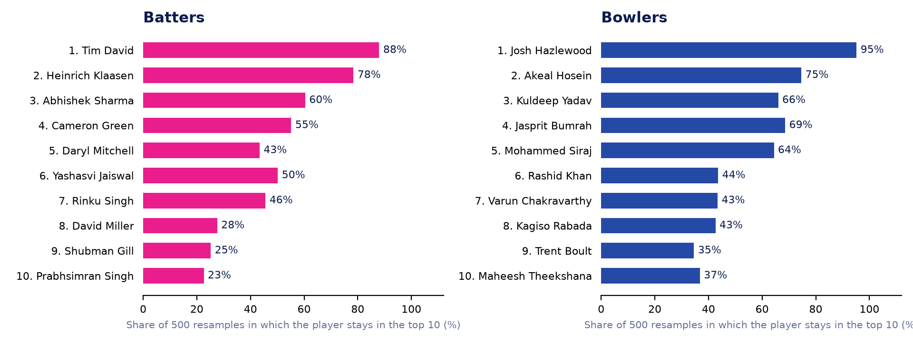
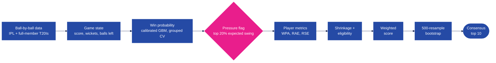
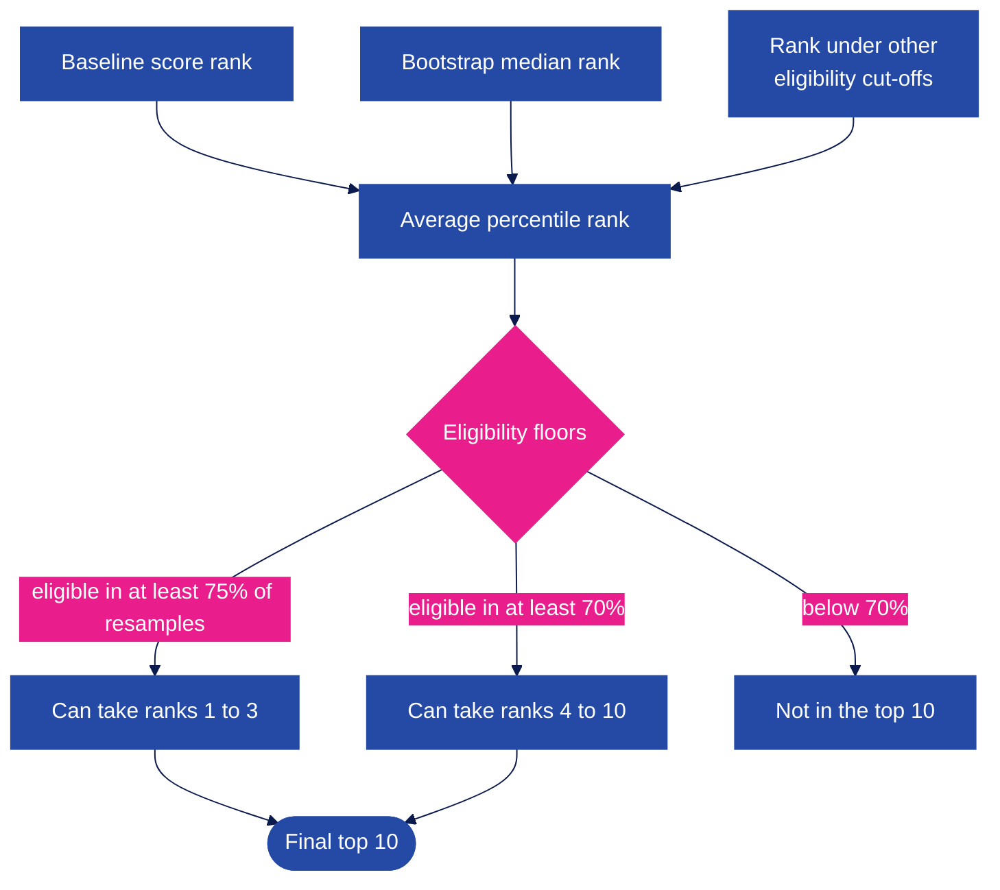
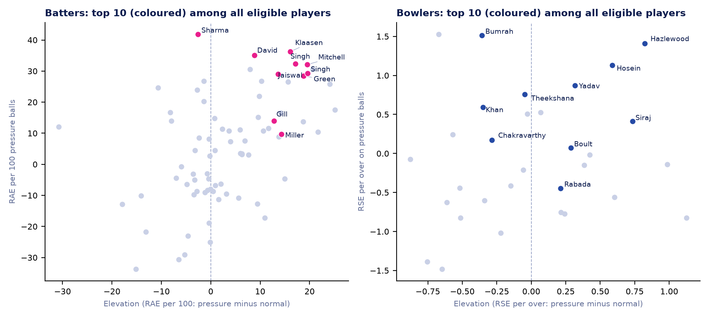
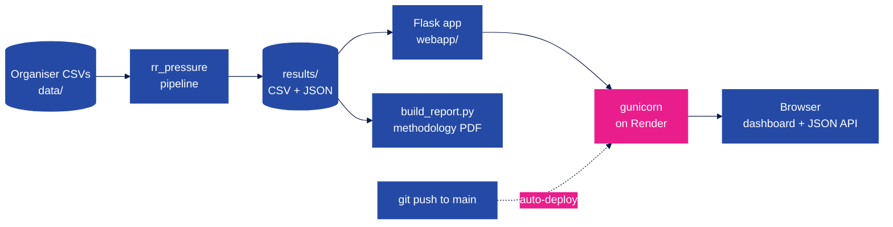

<p align="center">
  
</p>

<h1 align="center">Pressure Players</h1>

<p align="center">
  <b>Who delivers when the game is on the line?</b><br>
  Rating T20 batters and bowlers on how they perform under pressure, compared with their own usual level.<br>
  <i>SupeRR Selector Season 2 · Round 1</i>
</p>

<p align="center">
  
  
  
  
  
</p>

<p align="center">
  <a href="https://rr-pressure-players.onrender.com"><b>Live dashboard</b></a> ·
  <a href="reports/SupeRR_Selector_Season2_Round1_Methodology_Report.pdf"><b>Methodology report (PDF)</b></a> ·
  <a href="Final_v2.ipynb"><b>Analysis notebook</b></a>
</p>

> The free Render instance sleeps when idle, so the first load of the live link can take about a minute.

---

## Contents

[Highlights](#highlights) · [Final top 10](#final-top-10) · [How it works](#how-it-works) · [Evidence](#evidence) · [Project structure](#project-structure) · [Quick start](#quick-start) · [Deployment](#deployment) · [API](#api) · [Limitations](#limitations)

---

## Highlights

| | | | |
|:---:|:---:|:---:|:---:|
| **761**<br>matches (362 IPL, 399 T20Is) | **180,345**<br>deliveries scored | **2.8x**<br>larger swing on pressure balls | **500**<br>bootstrap resamples |

- **Pressure is measured, not guessed:** the expected swing in win probability on the next ball, not fixed rules like "death overs".
- **Fair to small samples:** Empirical Bayes shrinkage and minimum pressure balls.
- **Compared with the player's own level:** an elevation score rewards players who step up.
- **Honest about uncertainty:** every player has a top-10 chance from a match-level bootstrap.
- **Reproducible:** one scikit-learn model family, fixed seeds, folds grouped by match.

## Final top 10

| # | Batters | Top-10 chance | Bowlers | Top-10 chance |
|:---:|---|:---:|---|:---:|
| 🥇 | **Tim David** | 88% | **Josh Hazlewood** | 95% |
| 🥈 | **Heinrich Klaasen** | 78% | **Akeal Hosein** | 75% |
| 🥉 | **Abhishek Sharma** | 60% | **Kuldeep Yadav** | 66% |
| 4 | **Cameron Green** | 55% | **Jasprit Bumrah** | 69% |
| 5 | **Daryl Mitchell** | 43% | **Mohammed Siraj** | 64% |
| 6 | **Yashasvi Jaiswal** | 50% | **Rashid Khan** | 44% |
| 7 | **Rinku Singh** | 46% | **Varun Chakravarthy** | 43% |
| 8 | **David Miller** | 28% | **Kagiso Rabada** | 43% |
| 9 | **Shubman Gill** | 25% | **Trent Boult** | 35% |
| 10 | **Prabhsimran Singh** | 23% | **Maheesh Theekshana** | 37% |

Order is a consensus of the baseline score, the bootstrap median rank and the ranks under other eligibility cut-offs. **Ranks 1 to 3 in each list are firm; ranks 4 to 10 are close.** Full tables are in [`results/`](results/).

<p align="center">
  
  <br><sub>How often each top-10 player stays in the top 10 across 500 match-level resamples.</sub>
</p>

## How it works



**1. Scope.** IPL plus T20Is between the 12 ICC full members, from 2022-01-01. Abandoned matches and super overs are excluded.

**2. Win probability.** One gradient-boosted model per innings, calibrated and scored out-of-fold with folds grouped by match (second-innings Brier score **0.132**, first innings **0.227**).

**3. Pressure.** Before every ball, the expected swing in win probability across four outcomes, weighted by how often each happens in that phase. The top 20% of balls in each innings are pressure balls.

$$LI(s)=\sum_{o\in\{\text{dot},\,\text{run},\,\text{boundary},\,\text{wicket}\}} P(o\mid \text{phase})\,\big|WP(s\oplus o)-WP(s)\big|$$

**4. Player metrics.**

| | Batters | Bowlers |
|---|---|---|
| Impact on winning | WPA per 100 balls (35%) | WPA per over (25%) |
| Against the situation | RAE per 100 balls (25%) | Inverse economy (30%) |
| Elevation (pressure minus normal) | RAE (20%) | RSE per over (15%) |
| Raw rate | Strike rate (10%) | True dot-ball % (20%) |
| Consistency | Share of positive innings (10%) | Share of positive spells (10%) |

*WPA = win probability added, RAE = runs above expected, RSE = runs saved above expected. Percentages are the score weights.*

**5. Consensus ranking.**



## Evidence

**Does the pressure flag separate pressure from ordinary play?**

| Measure | Ordinary balls | Pressure balls |
|---|:---:|:---:|
| Average win-probability swing | 0.011 | **0.031** (2.8x) |
| Share in contests at 25-75% win probability | 62% | **82%** |
| Share in overs 16 to 20 | 20% | **30%** |

**How repeatable are the ratings?** Split-half reliability (odd against even matches, Spearman-Brown corrected): batter strike rate **0.57**, batter win probability added **0.41**, bowler economy **0.63**. Reliability is moderate, so every player carries a top-10 chance.

<p align="center">
  
  <br><sub>The top 10 (coloured) among all eligible players. Right of the dashed line means better under pressure than in normal play.</sub>
</p>

<details>
<summary><b>Robustness checks</b></summary>

- **Weights:** alternative weightings keep 8 to 9 of the baseline batter top 10 and 7 to 9 of the baseline bowler top 10 (rank correlation 0.935 or higher).
- **Eligibility cut-offs:** re-ranking at other cut-offs keeps 4 to 10 of the baseline top 10, which is why the final order is a consensus.
- **Bootstrap:** 500 match-level resamples rerun eligibility, shrinkage, scoring and ranking.
- **Leakage controls:** folds grouped by match with an assertion that no match is in both train and validation; venue par scores leave out the scored match.

</details>

The full write-up is in the [methodology report (PDF)](reports/SupeRR_Selector_Season2_Round1_Methodology_Report.pdf).

## Project structure

```
.
├── Final_v2.ipynb              # the full analysis as one narrated notebook, with outputs
├── run_pipeline.py             # runs the same pipeline from the command line
├── rr_pressure/                # ML pipeline, one module per stage
│   ├── data_prep.py            #   load, scope, delivery accounting
│   ├── game_state.py           #   score, wickets, balls left, target, required rate, venue par
│   ├── win_prob.py             #   calibrated win-probability models
│   ├── pressure.py             #   leverage, pressure flag, win probability added
│   ├── expected_runs.py        #   runs above / saved above expected
│   ├── batters.py, bowlers.py  #   metrics, shrinkage, elevation, scores
│   ├── bootstrap.py            #   500-resample match-level bootstrap
│   ├── validation.py           #   reliability and sensitivity tests
│   ├── consensus.py            #   final ranking and submission CSVs
│   ├── export.py               #   headline metrics for the web app
│   └── utils.py, common.py, pipeline.py
├── webapp/                     # Flask app deployed on Render
│   ├── __init__.py, routes.py, data_store.py, content.py, wsgi.py
│   ├── templates/              #   page templates
│   └── static/                 #   CSS, JS, logo
├── results/                    # pipeline outputs the web app serves
├── reports/                    # methodology report PDF and its figures
├── tests/                      # unit tests for the pipeline helpers and the API
├── data/                       # organiser CSVs (not committed, see data/README.md)
├── render.yaml, Procfile, requirements-web.txt   # deployment
└── requirements.txt            # everything needed to run and test the project
```

## Quick start

Python 3.12 or newer is recommended.

```bash
git clone https://github.com/YashasP19/RR-ML-Submission.git
cd RR-ML-Submission
python -m venv .venv && source .venv/bin/activate
pip install -r requirements.txt
```

<details>
<summary><b>Run the pipeline</b></summary>

The organiser's data files are not included. Place `ball_by_ball.csv`, `matches.csv`, `competitions.csv`, `teams.csv`, `playing_eleven.csv` and `competition_team_player_mapping.csv` in `data/` (see [`data/README.md`](data/README.md)), then:

```bash
python run_pipeline.py --data-dir data --out-dir results
```

A full run takes several minutes (win-probability models and 500 bootstrap resamples). Only scikit-learn gradient boosting is used with fixed seeds, so results are the same on any machine, and rerunning the modular pipeline gives output identical to the notebook.

</details>

<details>
<summary><b>Run the tests and the web app</b></summary>

```bash
python -m pytest -q tests                      # unit and API tests
gunicorn webapp.wsgi:app -b 127.0.0.1:8000     # then open http://127.0.0.1:8000
```

</details>

## Deployment

The site is a Flask app served by gunicorn. It only reads the files in `results/`, so the deployed service needs neither the raw data nor the ML libraries.



**Live:** [https://rr-pressure-players.onrender.com](https://rr-pressure-players.onrender.com) (Render, free plan, Python 3.12).

### Deploy your own copy on Render

1. Push this repository to GitHub. The `results/` folder must be committed.
2. In the [Render dashboard](https://dashboard.render.com) choose **New**, then **Blueprint**, and connect the repository.
3. Render reads [`render.yaml`](render.yaml) and creates the `rr-pressure-players` web service. Click **Apply**.
4. Wait for the build (about a minute), open the service URL, and check `/api/health` returns `{"status":"ok"}`.

<details>
<summary><b>Manual setup, updating and configuration</b></summary>

To create the service by hand instead, choose **New**, then **Web Service**, and use:

| Setting | Value |
|---|---|
| Runtime | Python 3 |
| Build command | `pip install -r requirements-web.txt` |
| Start command | `gunicorn webapp.wsgi:app --workers 2 --threads 4 --timeout 60` |
| Health check path | `/api/health` |
| Environment | `PYTHON_VERSION=3.12.7` |

The [`Procfile`](Procfile) has the same start command for Heroku-style platforms.

**Updating the live site:** rerun the pipeline, commit the new files in `results/`, and push to `main`. Render redeploys automatically.

| Variable | Purpose | Default |
|---|---|---|
| `RESULTS_DIR` | Folder the app reads results from | `./results` |
| `PYTHON_VERSION` | Python version on Render | `3.12.7` |

</details>

## API

| Endpoint | Returns |
|---|---|
| `GET /api/health` | Service status (`503` if result files are missing) |
| `GET /api/rankings/<batters\|bowlers>?limit=10` | Consensus top players |
| `GET /api/players/<kind>?q=&sort=&limit=` | All eligible players, searchable and sortable (`rank`, `pressureBalls`, `pTop10`, `elevation`, `consistency`) |
| `GET /api/players/<kind>/<slug>` | One player |
| `GET /api/metrics` | Headline numbers (pressure swing, reliability, counts) |
| `GET /api/method` | Method steps shown on the site |

Try it: [`/api/rankings/batters?limit=3`](https://rr-pressure-players.onrender.com/api/rankings/batters?limit=3)

## Limitations

- Opposition strength is not adjusted; all deliveries between full members count equally.
- Pressure is defined through a model, so a different win-probability model could move some names.
- The first-innings model is weak (Brier 0.227), so first-innings pressure labels are noisier.
- Reliability is moderate, so the order within ranks 4 to 10 should be read as close.
- Some players rest on one competition only and are flagged in the report.

---

<sub>The competition data and the problem statement belong to the SupeRR Selector organisers and are not included. The Rajasthan Royals name and logo belong to their owners and are used here only to present this challenge entry.</sub>
